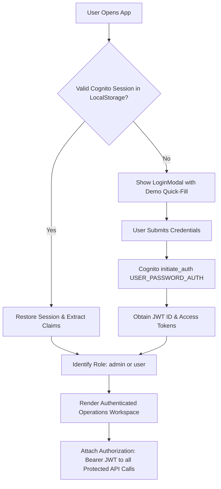

# DrainGuard — Frontend Architecture & Documentation

## Overview

The DrainGuard frontend is a high-performance, responsive Single Page Application (SPA) designed as an iOS-inspired, minimalist environmental operations workspace. It interfaces directly with Amazon Cognito User Pools for authentication and Amazon API Gateway HTTP API v2 for report triage, map visualizations, and photo uploads.

---

## 1. Technology Stack

- **Core Framework**: React 18 + TypeScript 5
- **Build Tool**: Vite 8 (Rolldown engine)
- **Styling**: Tailwind CSS 4 with custom iOS-inspired light design tokens
- **Maps & Geospatial**: Leaflet 1.9 + React-Leaflet 4 + OpenStreetMap tiles
- **Authentication**: `amazon-cognito-identity-js`
- **Iconography**: `lucide-react` (Strict zero-emoji aesthetic)
- **Unit Testing**: Vitest 5 + React Testing Library + jsdom

---

## 2. Directory Structure

```
frontend/
├── src/
│   ├── components/
│   │   ├── LoginModal.tsx          # Minimalist iOS authentication card with quick-fill demo buttons
│   │   ├── ReportList.tsx          # Triage operations queue with live search, filters & risk badges
│   │   ├── ReportMap.tsx           # Interactive Leaflet map, custom SVG pins, map-picker crosshairs
│   │   ├── ReportDetail.tsx        # Comprehensive inspection panel with role-based status controls
│   │   └── SubmitReportModal.tsx   # Modal for reporting blockages, S3 photo upload & map coords
│   ├── context/
│   │   └── AuthContext.tsx         # Global session provider with auto-restoration & token refresh
│   ├── services/
│   │   ├── api.ts                  # Centralized HTTP client attaching Cognito Bearer JWT tokens
│   │   └── auth.ts                 # Cognito User Pools wrapper (signIn, signOut, getSession)
│   ├── test/
│   │   ├── api.test.ts             # API client mock tests
│   │   ├── auth.test.tsx           # Login modal, quick-fill & RBAC permission tests
│   │   └── components.test.tsx     # Report detail, risk tier & filter component tests
│   ├── types/
│   │   └── index.ts                # TypeScript interfaces (ReportItem, AuthUser, RiskScore)
│   ├── utils/
│   │   └── helpers.ts              # Risk tier coloring, formatters, SLA time calculations
│   ├── App.tsx                     # Top-level shell, header metrics, and responsive desktop/mobile layout
│   ├── index.css                   # Tailwind CSS tokens, Leaflet map styling overrides
│   └── main.tsx                    # Application entry point with window.global polyfills
├── index.html                      # Semantic HTML5 shell with Google Fonts preconnects
├── package.json                    # Dependencies and build scripts
├── tsconfig.json                   # Strict TypeScript compiler options
└── vite.config.ts                  # Vite build configuration with root output for Amplify hosting
```

---

## 3. Design Tokens & Visual Hierarchy

The interface implements a restrained Apple-inspired light aesthetic:

| Token Name | Value | Usage |
|---|---|---|
| Main Background | `#F5F6F8` | Canvas background for the operations workspace |
| Primary Surface | `#FFFFFF` | Card surfaces, modals, navigation headers, detail panels |
| Subtle Surface | `#FAFAFA` | Sub-sections, form input backgrounds, metadata chips |
| Primary Border | `#E6E8EC` | 1px border dividers, subtle component separation |
| Primary Text | `#17191C` | High-contrast headers, risk scores, primary labels |
| Secondary Text | `#696F78` | Subtitles, timestamps, unit labels, explanations |
| Muted Text | `#9298A1` | Placeholders, inactive counts, breadcrumbs |
| Brand Primary Accent | `#157A70` | Primary action buttons, active navigation markers, selection borders |
| Accent Soft Surface | `#E8F4F1` | Badge backdrops, active selection states |
| Critical Risk | `#D9383A` | Critical severity blockage indicators, SLA < 4h tags |
| High Risk | `#E67E22` | High severity blockage indicators, SLA < 24h tags |
| Moderate Risk | `#F1C40F` | Moderate priority tags |
| Resolved / Success | `#16A34A` | Resolved incidents, operational health check indicator |

---

## 4. Authentication & RBAC State Flow



### Role-Based UI Adaptations

- **Demo Community User (`user`)**:
  - Displays `USER (user@drainguard.demo)` badge in header.
  - Can browse map and triage list.
  - Can submit new reports and upload photos via direct presigned S3 POST.
  - Inspecting a report shows a read-only lock banner: *"Status changes restricted to dispatchers and administrators"*.
  - Forward transition action buttons are completely removed from DOM.
- **Demo Administrator (`admin`)**:
  - Displays `ADMIN (admin@drainguard.demo)` badge in header.
  - Inspecting an `open` report renders the primary action button: `Advance to In Progress ->`.
  - Inspecting an `in_progress` report renders: `Advance to Resolved ->`.
  - Once resolved, displays green success state: *"Report resolved. Flow verified clear."*

---

## 5. Photographic Evidence Pipeline (S3 Presigned POST)

1. The client requests a presigned policy from `POST /uploads/presign` with the report ID and image MIME type.
2. The backend generates AWS S3 presigned POST fields (`policy`, `x-amz-signature`, `x-amz-credential`, `key`).
3. The frontend creates a `FormData` object and POSTs the image binary directly to the private S3 bucket without routing heavy file bytes through Lambda.
4. Once S3 responds with HTTP 204 No Content, the report submission completes with the S3 image key attached.
5. In the report detail panel, images are fetched securely via temporary presigned GET URLs generated on-demand by `GET /reports`.

---

## 6. Build & Testing

```bash
# Run Vitest component, RBAC, and API client test suite (22 tests)
npm --prefix frontend run test -- --run

# Compile optimized production bundle for AWS Amplify
npm --prefix frontend run build
```
