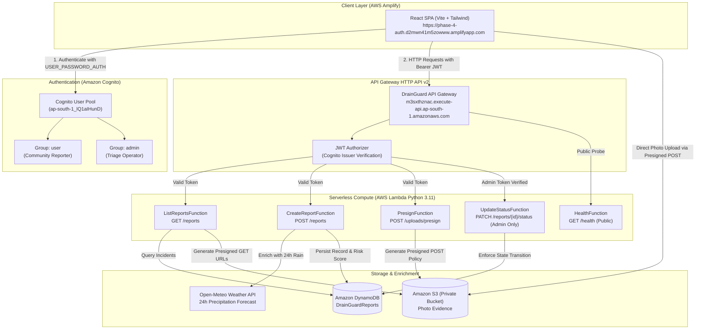
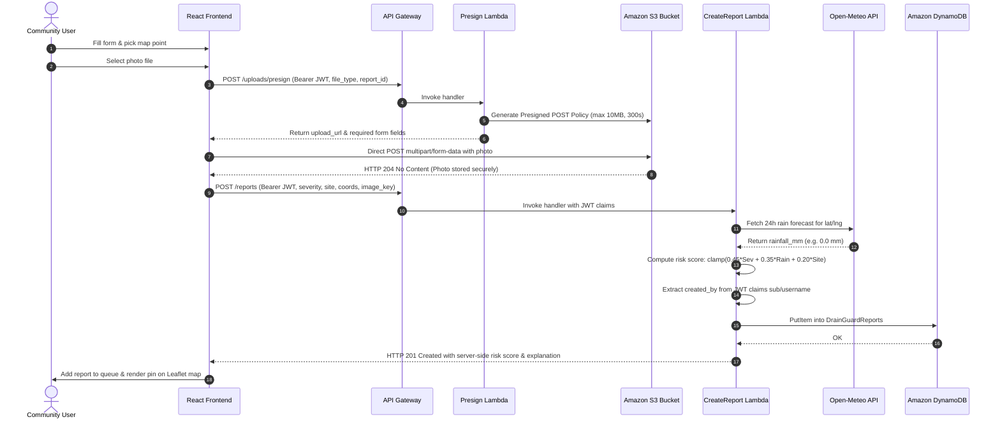
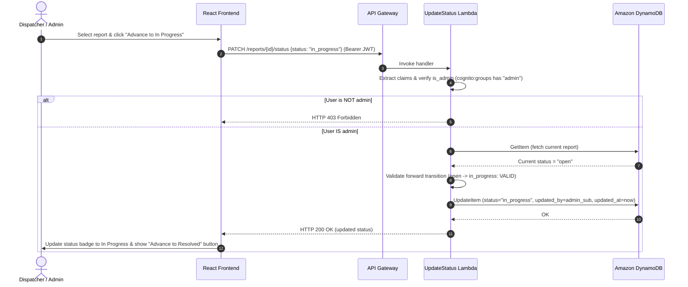

# DrainGuard / EnvironOS — Comprehensive Implementation & Operations Guide

**Amazon Environmental Hacks 2026 · Track 02: Heat and Water**  
**Repository**: [https://github.com/Dishan18/EnvironOS](https://github.com/Dishan18/EnvironOS)  
**Live Application**: [https://phase-4-auth.d2mwn41m5zowww.amplifyapp.com](https://phase-4-auth.d2mwn41m5zowww.amplifyapp.com)  

---

## 1. Repository Folder Structure

```
EnvironOS/
├── .aws-sam/                       # SAM build cache and generated CloudFormation templates
├── backend/                        # Python 3.11 AWS Lambda backend
│   ├── src/
│   │   ├── handlers/               # Event handlers for API Gateway HTTP API v2 routes
│   │   │   ├── create_report.py    # POST /reports
│   │   │   ├── list_reports.py     # GET /reports
│   │   │   ├── update_status.py    # PATCH /reports/{id}/status
│   │   │   ├── presign.py          # POST /uploads/presign
│   │   │   └── health.py           # GET /health
│   │   └── lib/                    # Shared utility modules
│   │       ├── auth_utils.py       # Cognito claims & transition validation
│   │       ├── dynamo_client.py    # DynamoDB boto3 client wrapper
│   │       ├── http_utils.py       # Response formatters & CORS headers
│   │       ├── risk_score.py       # Deterministic 0-100 heuristic
│   │       ├── s3_client.py        # Presigned POST/GET generator
│   │       ├── validate.py         # Payload validation
│   │       └── weather.py          # Open-Meteo precipitation client
│   ├── requirements.txt            # Production Lambda dependencies
│   └── requirements-dev.txt        # Local testing dependencies
├── frontend/                       # React 18 + TypeScript + Vite 8 SPA
│   ├── src/
│   │   ├── components/             # Reusable UI components
│   │   │   ├── LoginModal.tsx      # iOS-style authentication dialog
│   │   │   ├── ReportList.tsx      # Triage queue with search & filters
│   │   │   ├── ReportMap.tsx       # Leaflet interactive map & pins
│   │   │   ├── ReportDetail.tsx    # Inspection panel & status workflow
│   │   │   └── SubmitReportModal.tsx # Blockage report creation dialog
│   │   ├── context/
│   │   │   └── AuthContext.tsx     # Session management & user state
│   │   ├── services/
│   │   │   ├── api.ts              # API client with Bearer token injection
│   │   │   └── auth.ts             # Amazon Cognito SDK wrapper
│   │   ├── test/                   # Vitest unit test suite (22 tests)
│   │   ├── types/                  # Shared TypeScript interfaces
│   │   ├── utils/                  # Color mappings, time formatting
│   │   ├── App.tsx                 # Top-level shell & responsive layout
│   │   ├── index.css               # Tailwind CSS & design tokens
│   │   └── main.tsx                # React DOM root & global polyfills
│   ├── package.json
│   ├── tsconfig.json
│   └── vite.config.ts              # Optimized build configuration
├── infrastructure/                 # Infrastructure as Code (AWS SAM)
│   ├── scripts/
│   │   ├── deploy.ps1              # Deployment script for SAM & Amplify
│   │   └── provision_demo_users.py # Idempotent Cognito user provisioning
│   ├── samconfig.toml              # SAM CLI configuration
│   └── template.yaml               # CloudFormation template (Cognito, API GW, Lambda, DynamoDB, S3)
├── tests/
│   └── python/                     # Pytest suite (74 tests)
├── amplify.yml                     # AWS Amplify Hosting build specification
├── backend.md                      # Backend architectural documentation
├── frontend.md                     # Frontend architectural documentation
├── guide.md                        # This comprehensive guide
└── README.md                       # Hackathon project overview & login credentials
```

---

## 2. High-Level Design (HLD)

DrainGuard connects citizens, municipal workers, and triage operators through a fully managed, serverless architecture in AWS Mumbai (`ap-south-1`):



---

## 3. Low-Level Design (LLD)

### Report Creation & S3 Evidence Sequence



### Administrative Workflow Advancement Sequence



---

## 4. How to Use DrainGuard

### Demo Login Credentials

| Account | Email / Username | Password | Role / Group |
|---|---|---|---|
| **Demo Admin** | `admin@drainguard.demo` | `admin12345` | `admin` (Dispatcher / Municipal Lead) |
| **Demo User** | `user@drainguard.demo` | `user12345` | `user` (Community Citizen Reporter) |

---

### Step-by-Step Walkthrough

#### 1. Citizen / Community Workflow (Reporting an Incident)
1. Navigate to [https://phase-4-auth.d2mwn41m5zowww.amplifyapp.com](https://phase-4-auth.d2mwn41m5zowww.amplifyapp.com).
2. On the **DrainGuard Access** card, click the **Demo User** quick-fill button, then click **Sign In**.
3. Notice the **USER (`user@drainguard.demo`)** badge in the header.
4. Click **+ Report Drain Blockage** in the top right.
5. In the report modal:
   - Enter a description (e.g. *"Heavy silt blocking roadside inlet"*).
   - Select **Blockage Severity** (e.g. *High* or *Critical*).
   - Select **Site Type** (e.g. *Arterial Road* or *Commercial Zone*).
   - (Optional) Upload a photo from your computer.
   - Click **Select on Map** to activate interactive coordinate picking.
   - Click anywhere on the map to place the coordinate marker. Your form input and photo draft are automatically preserved.
6. Click **Submit Report**.
7. The report is uploaded, scored by the backend heuristic, enriched with live weather, and immediately appears in the queue and map with its calculated risk score.
8. Click on your report to inspect the **Triage Factor Breakdown**. Notice that the status update controls are locked, showing the read-only notice for community accounts.

#### 2. Dispatcher / Administrator Workflow (Triage & Resolution)
1. Click the **Sign Out** button in the top header.
2. On the login screen, click the **Demo Admin** quick-fill button, then click **Sign In**.
3. Notice the **ADMIN (`admin@drainguard.demo`)** badge in the header.
4. Select any incident with status **Open Incident**.
5. In the inspection panel, the admin workflow action **Advance to In Progress ->** is active.
6. Click **Advance to In Progress ->**.
7. The incident status transitions immediately to **In Progress**, and your admin account UUID is recorded in `updated_by`.
8. Once cleaning crews clear the drain, click **Advance to Resolved ->**.
9. The status transitions to **Resolved**, a green checkmark marker is placed on the map, and the resolution timestamp is permanently saved to DynamoDB.
10. Refresh the page to confirm that the changes persisted in the live database.

---

## 5. Deployment Instructions

### Backend & Infrastructure Deployment (AWS SAM)

```powershell
# 1. Build SAM functions and validate template
sam build -t infrastructure\template.yaml

# 2. Deploy to AWS Asia Pacific (Mumbai)
sam deploy --config-file infrastructure\samconfig.toml

# 3. Provision the two demo accounts idempotently
python infrastructure\scripts\provision_demo_users.py <COGNITO_USER_POOL_ID> ap-south-1
```

### Frontend Deployment (AWS Amplify Hosting)

```powershell
# 1. Compile production frontend bundle
npm --prefix frontend run build

# 2. Package build artifacts
python -c "
import zipfile, os
with zipfile.ZipFile('frontend_build.zip', 'w', zipfile.ZIP_DEFLATED) as z:
    for f in os.listdir(r'frontend/dist'):
        full = os.path.join(r'frontend/dist', f)
        if os.path.isfile(full):
            z.write(full, f)
"

# 3. Deploy to AWS Amplify branch
python infrastructure/scripts/deploy_amplify.py
```
